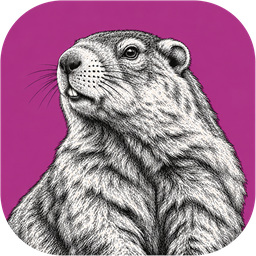
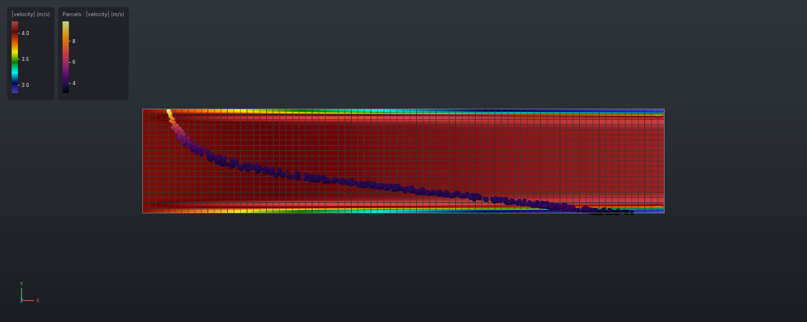
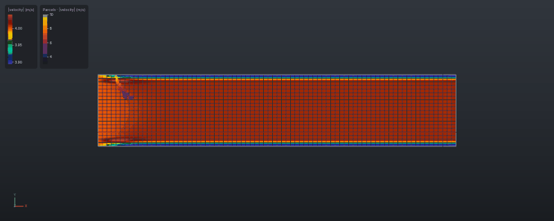
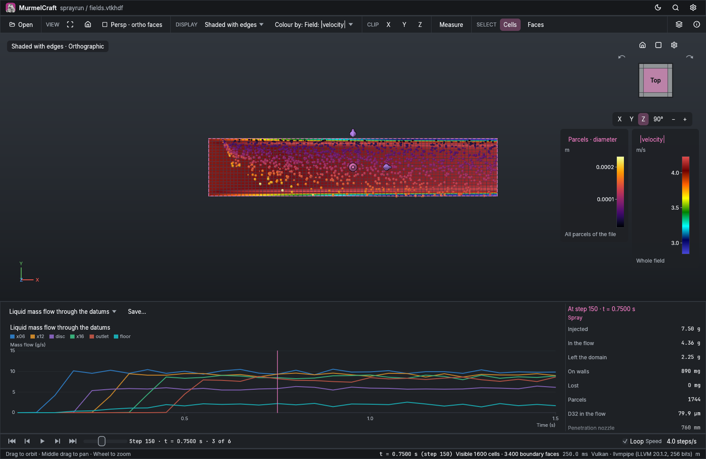

<p align="center"></p>

# MurmelCraft

The shared desktop viewer of [KoflCraft](https://github.com/chiefenne/KoflCraft)
(polyhedral CFD mesher) and [FoehnCraft](https://github.com/chiefenne/Foehncraft)
(CFD solver), named after the Murmeltier, the Alpine lookout. Rust, egui and
eframe on wgpu; one engine with thin front ends, every action a registered
tool that the window, the command line and the MCP server share.

<p align="center">
  <a href="assets/readme/tour"></a>
</p>

<sub>Screenshots of the window: a laminar FoehnCraft run (Re = 167) on
KoflCraft's Manifold mesh, 229,615 polyhedra and prisms. The slides are
also [full-size stills](assets/readme/tour); how they were made is in
[tools/readme-tour](tools/readme-tour/README.md).</sub>

[](https://github.com/chiefenne/MurmelCraft/actions/workflows/ci.yml)
[](Cargo.toml)
[](LICENSE)

## What works today

Not released yet (version 0.1.0): the V0.2 to V0.6 milestones of the UI
spec are done and V1.0 is in progress; [changelog.d](changelog.d) lists
every change.

- Opens KoflCraft's `foehncraft.vtu` (VTK polyhedra, boundary polygons, zone
  and patch names and roles) and the `mesh-evidence.json` beside it.
- Opens OpenFOAM meshes: a case, `constant` or `polyMesh` folder, or a
  `.foam` file in the case (ascii, binary and gzip files, `cellZones`),
  such as KoflCraft's `export … openfoam`; the evidence in the polyMesh
  folder is checked file by file.
- Opens FoehnCraft results (`fields.vtkhdf`, read by our own HDF5 reader)
  and the cell or point data of a `.vtu`, and colours the mesh by a field
  (`display.color_by` with `field`, `field.style`): flat (one colour per
  cell), smooth (node values rebuilt from the cells' gradients, so a
  linear field stays exactly linear) or banded, contour lines
  on or off with their own count, nine colour maps (Rainbow
  Desaturated by default, the same as in FoehnCraft and KoflCraft,
  Inferno second, Rainbow Uniform for ranges symmetric about zero), each reversible, and a
  colour bar with its settings menu. Properties and probes show the
  values.
- Slices and iso-surfaces of the results (`slice.set`, `slice.rotate`,
  `iso.set`): slices placed and moved like clip planes (handles, X/Y/Z,
  typed origin and normal), single or as a series with count and
  spacing, in the mesh's field style; iso-surfaces at one value each
  (typed, or clicked on the colour bar), solid or coloured by the field
  shown, by marching tetrahedra, smooth: values between cells come from
  least-squares cell gradients and the shading follows the field's
  slope. The mesh shows as a faint outline
  meanwhile, its faces one click away.
- Vector arrows (`arrows.set`, Alt + V): shaded 3D arrows of the velocity
  (or another vector field) on every slice, on an even grid of 40 across
  each slice (a density setting), and on the mesh surface on request; as
  long as the magnitude with a floor so slow flow still shows, strictly
  as long as the magnitude, or all the same length (with a length
  factor); the full vector or only its part in the slice; coloured by
  their own magnitude with their own colour bar, by the field shown, or
  solid.
- Streamlines (`stream.set`, Alt + L): up to 8 sets traced through the
  cells (fourth-order Runge-Kutta) from seeds on a line, in a ball, on a
  patch or on a plane, placed by drag handles that snap to the mesh or
  by typed points; downstream, upstream or both ways, stopping where the
  flow leaves the mesh, slows below 0.1 % of its top speed or reaches a
  length limit; thin lines, or shaded tubes with a radius setting and
  arrowheads on request; a solid colour, or any field with its own
  colour bar beside the mesh's, in exported pictures too.
- Spray parcels (`parcels.open`, `parcels.set`): the droplets of a
  FoehnCraft spray (`spray/parcels_<step>.vtkhdf`, or any VTKHDF PolyData
  of points) shown with the mesh and its fields as small shaded spheres,
  all the same size or sized by droplet diameter, coloured by any parcel
  field (diameter, a velocity component, age, …) with their own colour
  bar, map and range, or in one solid colour; filtered by a diameter
  range, an injector and the clip planes; a row in the model tree with
  eye and settings, kept in session files.

  

- Time series (`series.open`, `series.go`, `series.play`): the steps of
  one run, from FoehnCraft's `series.json` or an output folder of
  `fields_<step>.vtkhdf` and `spray/parcels_<step>.vtkhdf`. Each step
  shows its fields and parcels with the slices, colouring, parcel
  settings and camera kept; a player bar below the view (first, back,
  play or pause, on, last, a step slider, speed and loop; Space, comma
  and full stop) and the time in the status bar; `export.movie` with
  motion `series` makes a movie of the steps; session files keep the
  series and the step.

  

- Charts and statistics of a run (`charts.open`, `charts.show`,
  `charts.data`, `charts.export`, `stats.at`): FoehnCraft's `datums.csv`,
  `spray.csv` and size histograms `spray_hist_<datum>.csv`, read without
  the solver. Time-series charts of the liquid mass flow through the
  datums, the liquid through them so far, the spray penetration per
  injector, the Sauter diameter D32 through each datum and in the flow,
  or any columns of one unit; the droplet size histogram of a datum by
  mass or by number, up to the step or of its interval. A panel below
  the view draws the chart with a cursor at the player's step and the
  statistics at that step beside it: the spray's mass book, penetration,
  and per datum the liquid through it, its rate, D10, D32, Dv50 and
  Dv10/Dv90 from the bins. `series.open` opens the charts of its folder;
  `charts.export` writes any chart as PNG or SVG; six series hues of our
  own, checked for colour-vision deficiencies.

  

- Derived fields (`field.derive`, the Derived fields window): vorticity,
  Q criterion, λ₂, total pressure and pressure coefficient computed from
  the result's velocity and pressure (the velocity gradient by least
  squares in each cell), with FoehnCraft's names and units. They join the
  file's fields for colouring, slices, iso-surfaces, arrows and
  streamlines, and sessions save how each was made. The reference values
  come from FoehnCraft's case beside the result, else your defaults.
- Field calculator (`field.calculate`, the Derived fields window's Your
  formulas tab, palette "Field calculator…"): your own formulas of the
  result's fields, such as `mag(velocity)`, `p - 101325`,
  `dot(U, curl(U))` or `if(x > 0, p, 0)`: arithmetic, components (`U.x`),
  vectors, the coordinates, 27 functions, and `grad`, `curl` and `div`
  by the same least-squares gradients. Keep a formula to have it for
  every result (settings.toml); a field made from another is computed
  again when that one changes.
- Shaded with edges, shaded, wireframe or feature edges (keys 1 to 4);
  one solid colour (green by default) or colours by patch, patch role,
  cell type, cell zone or cell quality (non-orthogonality, skewness,
  volume ratio, face count) with a histogram and a threshold that shows
  only the worst cells. Every colour is configurable, dark and light
  themes switch live.
- Your defaults: right-click a value or an item (arrows, slices,
  iso-surfaces, streamlines, clip planes, regions, field colouring, the
  render mode and projection, the reference values of derived fields) to
  save it as your default
  (`settings.set_default`); new items start from it, items already open
  keep theirs, and Settings lists each default with a Forget button.
- Model tree (T): the mesh with its evidence badge, cell zones, cell
  types, patches, saved views (Ctrl + B), clip planes, slices,
  iso-surfaces, arrows, streamlines, regions, measurements and probes,
  each with an
  eye, a context menu and double click to fit; H hides, I isolates.
- Picking of cells and faces and a Properties panel (P) for the mesh,
  any item, a cell, a face or a probe, with the field values of results.
- Orbit about the point under the cursor, pan, zoom to the cursor, fit,
  home, the three projection modes (default: perspective with orthographic
  faces), cursor coordinates, and a view cube with all 26 views and roll
  arrows, placed in any corner, floating, hidden or shown on approach.
- Up to 8 clip planes, crinkle (whole cells) or flat (cut cells), moved
  by drag handles (slide arrow and tilt arcs), X/Y/Z, keys or typed
  values; on large meshes the GPU cuts at once while dragging and the
  exact cut follows.
- Regions of interest (Alt + R): a box, sphere, slab, cell zone, layers
  along a patch or picked cells, whole cells or cut flat; only their cells
  are shown and computed. On a mesh beyond the memory budget, open as an
  overview, a box, sphere or slab reads the cells of the blocks it
  touches.
- Measuring (M) with snapping to nodes, edge midpoints and face or cell
  centres (distances and angles), and probes (Shift + P) that read every
  field at a point; both stay in the tree.
- Undo and redo of the camera and the display (Ctrl + Z, Ctrl + Shift + Z),
  a command palette (Ctrl + K) and a shortcut sheet (F1,
  [docs/keys.md](docs/keys.md)).
- Session files (`.murmel`, Ctrl + S): mesh, camera, display, clip planes,
  saved views, regions, measurements ([docs/sessions.md](docs/sessions.md)).
- Large meshes: files read, surfaces built and edges found on all threads,
  files checked with BLAKE3 after the mesh shows, edges hidden while orbiting only
  when frames get slow ([docs/performance.md](docs/performance.md),
  `murmel bench`). A blocked VTKHDF file that needs more than the memory
  budget (half the computer's memory unless set in Settings) opens as an
  overview: its boundary with the cell fields on it, without reading the
  cells, and slices, iso-surfaces and arrows across the whole volume on a
  preview grid of the cell fields, with the boxes of its blocks on
  request ([docs/blocked-vtkhdf.md](docs/blocked-vtkhdf.md)).
- Mouse presets (three-button, Apple, Fusion, ParaView), every binding
  editable through `settings.set_bindings` and saved in `navigation.toml`.
- Title bar, toolbar, viewport with view note and axis triad, status bar.
- Headless screenshots with `murmel call view.screenshot`, checked by
  render tests in CI.
- Picture export for reports and posters (`export.image`, File, "Export
  image…", Ctrl + Shift + E): any size up to 8192 pixels or a scale of the
  viewport, lines and legend scaled to match, colour legend and axis triad
  each optional, transparent background, dpi for print
  ([docs/export.md](docs/export.md)).
- Movies (`export.movie`, "Export movie…", Ctrl + Shift + M): the camera
  turning around, a clip plane sweeping through the mesh, or a flight
  through saved views, as an MP4 (with the ffmpeg installed on the
  machine), a GIF or PNG frames, made in the background with a progress
  bar and Cancel.
- An MCP server for agents (`murmel mcp`, [docs/mcp.md](docs/mcp.md)): every
  tool of the registry on one headless session, paths confined to read and
  write roots, screenshots returned as images; with `--live` the agent
  drives the open window instead, its steps undoable, with a Stop button.
- Keyboard and screen-reader use ([docs/accessibility.md](docs/accessibility.md)):
  F6 between the regions, a visible focus ring, AccessKit names for every
  pane and control, palettes checked for WCAG AA contrast.

## Build and run

```sh
cargo run --release -p murmel-app -- test-fixtures/channel/foehncraft.vtu
cargo run --release -p murmel-app -- test-fixtures/openfoam/dual_polyhedra
cargo run --release -p murmel-cli -- call view.screenshot \
  --input '{"mesh": "test-fixtures/channel/foehncraft.vtu", "view": "iso", "path": "shot.png"}'
cargo run -p murmel-cli -- commands --markdown   # docs/tools.md
cargo run --release -p murmel-cli -- mcp --root .  # the MCP server on stdio
```

## Let Claude drive MurmelCraft (macOS, copy and paste)

`cargo build --release` builds three programs into `target/release/`:
`murmelcraft` (the window), `murmel` (the command line; `murmel mcp` is
the MCP server) and `murmel-mcp` (the same server on its own). Claude
Code needs the server's full path, so run these lines **in the
MurmelCraft folder** (`$PWD` fills the path in for you):

```sh
cargo build --release
mkdir -p ~/murmel-work                       # the folder the agent may read and write
claude mcp add --scope user murmelcraft-live -- \
  "$PWD/target/release/murmel" mcp --live --root ~/murmel-work
claude mcp list                              # murmelcraft-live: ... ✓ Connected
```

Then start the window (`target/release/murmelcraft`, or with a mesh:
`target/release/murmelcraft test-fixtures/channel/foehncraft.vtu`),
start `claude` in any folder and ask, for example, *"Use murmelcraft-live:
clip the mesh along x and show me a screenshot"*. Meshes the agent opens
must lie in `~/murmel-work` (or give it more folders with
`--read-root DIR`). For a session of its own without a window, add the
server without `--live` under another name:

```sh
claude mcp add --scope user murmelcraft -- \
  "$PWD/target/release/murmel" mcp --root ~/murmel-work
```

If it does not work:

- *`claude: command not found`*: Claude Code is not installed in this
  shell; install it, or open a new terminal after installing.
- *`MCP server murmelcraft-live already exists`*: remove the old entry
  first, `claude mcp remove murmelcraft-live --scope user` (or
  `--scope local` if it was added without `--scope`), and add it again.
- *Not listed in another folder*: without `--scope user` the server is
  added for the current folder only.
- *`✗ Failed to connect`*: the path is wrong or the program is not
  built; `ls "$PWD/target/release/murmel"` must show the file, and
  `target/release/murmel mcp --live --root ~/murmel-work` must print
  nothing and wait (Ctrl + C ends it). A root that does not exist stops
  it with a message.
- *`LIVE001`* in a call: no MurmelCraft window is open; *`LIVE003`* in
  Settings: a second window is open. Settings > Agents must be on.

More in [docs/mcp.md](docs/mcp.md).

Rules for contributors and agents: [AGENTS.md](AGENTS.md). Tools:
[docs/tools.md](docs/tools.md). MCP server: [docs/mcp.md](docs/mcp.md). Lessons: [docs/pitfalls.md](docs/pitfalls.md).

MIT licence. Fonts Inter and JetBrains Mono (SIL OFL 1.1), icons Lucide
(ISC); see [assets/PROVENANCE.md](assets/PROVENANCE.md).
