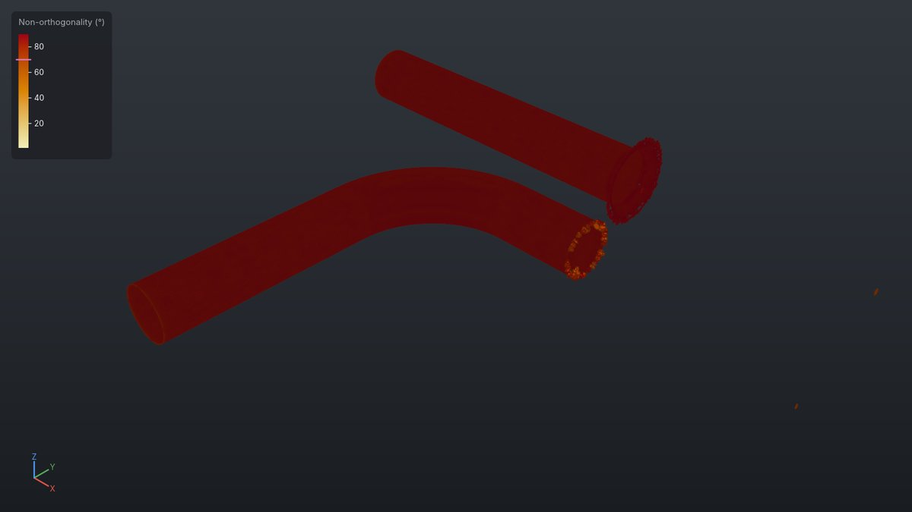
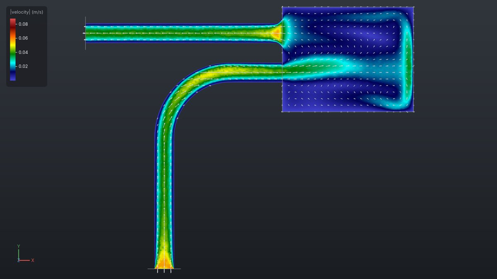
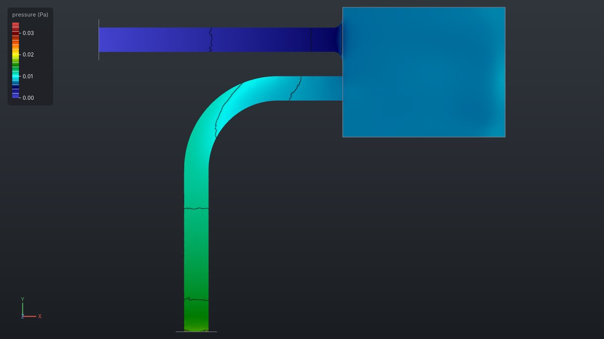
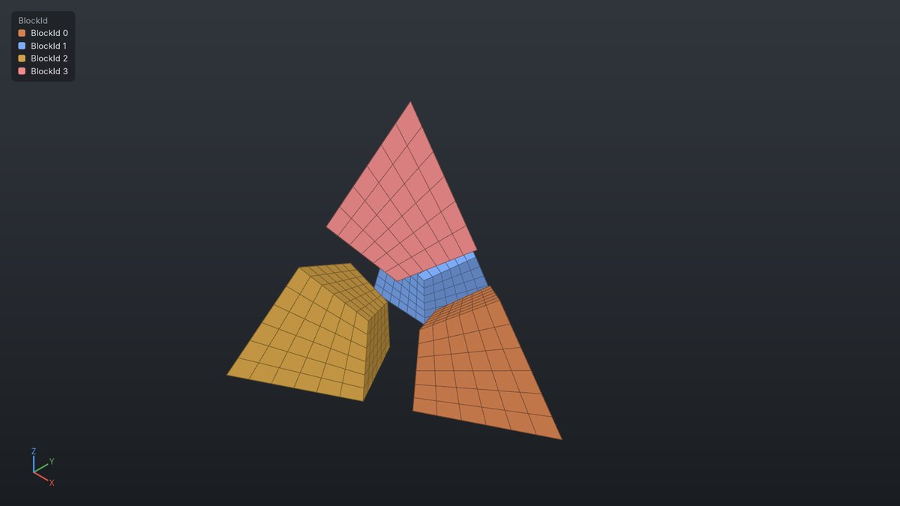

# Example chats

Four chats with an AI assistant (Claude) connected to MurmelCraft's MCP
server ([mcp.md](mcp.md)), each a typical job: check a mesh, see the
flow, read a number, show the blocks of a block mesh. The engineer types
one sentence; the assistant picks the tools, reads what comes back and
answers in a few lines.

Every call and every number below is from a real run of the calls through
`murmel mcp`, recorded by the small host
[`tools/agent/mcp_host.py`](../tools/agent/mcp_host.py). The calls of each
chat are in [`tools/agent/chats/`](../tools/agent/chats) (`*.json`), the
results as they came back beside them (`*.jsonl`, the work folder written
`<work>`). The pictures are the chats' own `export.image` files, scaled
for the page. Results are shortened in the tables; the journals have them
in full.

Contents:
[1. Is my mesh good enough?](#1-is-my-mesh-good-enough) ·
[2. Where does the air go?](#2-where-does-the-air-go) ·
[3. What is the pressure drop?](#3-what-is-the-pressure-drop) ·
[4. Show me the blocks](#4-show-me-the-blocks) ·
[Replay them](#replay-them)

The data: KoflCraft's Manifold fixture (a pipe with a bend into a box, an
outlet pipe; D = 50 mm), meshed with
`kofl generate-duct test-fixtures/manifold/manifold.stl test-fixtures/manifold/patches.json test-fixtures/manifold/partition.json polyhedral manifold-mesh`
(KoflCraft `9f7b1d1`): 137,682 polyhedra in mm. FoehnCraft (`7e49a77`)
ran laminar air on it with [manifold.toml](../tools/readme-tour/manifold.toml)
(U = 0.05 m/s, Re = 167, scaled to metres): `foehn flow manifold.toml --out run`,
converged in 147 iterations, 69 s on four CPU cores. Chat 4 uses the block
mesh of [test-fixtures/blocks](../test-fixtures/README.md). MurmelCraft
`d2fa34d`; the server ran headless (`murmel mcp --root <work>`), so the
assistant sees each picture as the PNG the call returns. With
`murmel mcp --live` the same calls run in your open window instead.

## 1. Is my mesh good enough?

> *"I meshed the Manifold with KoflCraft. Is the mesh good enough for
> FoehnCraft, and where are the worst cells?"*

| # | Call | What came back |
|---|---|---|
| 1 | `mesh.open` `{"path": "manifold-mesh/foehncraft.vtkhdf"}` | 137,682 cells, patches `inlet`, `outlet`, `walls`; KoflCraft's evidence beside it: 0 inverted faces, closure 2·10⁻¹⁴ |
| 2 | `inspect.quality` `{"metric": "non_orthogonality", "above": 70}` | mean 34.1°, max 90.0°; **23,028 cells at 70° or more**; the histogram has a second peak in its last bin (21,063 cells at 85.5° to 90°) |
| 3 | `inspect.quality` `{"metric": "skewness", "above": 0.9}` | mean 0.17, max 1.24; 81 cells at 0.9 or more |
| 4 | `probe.at` a point 0.04 mm inside the inlet pipe's wall `{"point": [0, 30, 24.96]}` | cell 22688, a polyhedron of 0.58 mm³, worst non-orthogonality **85.9°**, skewness 0.03 |
| 5 | `probe.at` the pipe's axis `{"point": [0, 30, 0]}` | cell 20219, 343 mm³, 24.4°, skewness 0.11 |
| 6 | `display.threshold` `{"metric": "non_orthogonality", "value": 70}` | 23,028 cells left in view |
| 7–9 | `view.standard` iso, `view.zoom` 0.6, `export.image` | the picture below |

<p align="center"></p>

The answer: *"Usable, with one thing to know. The core is good (mean
34°, the pipe axis 24°). The 23,028 cells above 70° are the thin wall
layer of the round pipes and the bend (first layer 0.08 mm thick), with
low skewness (0.03 in the probed one); the box walls are clean.
FoehnCraft's own check (`foehn mesh`) finds the same largest value,
89.997°, and at a wall face, so it is the angle between a wall face and
the way to its thin cell's centre. FoehnCraft ran the case to convergence,
with its automatic remediation for 94 skewed faces."*

One slip to read past: the probe labels the coordinates `m`. A KoflCraft
mesh is in the units of its STL (mm here) and the file names none, so
MurmelCraft shows its default.

## 2. Where does the air go?

> *"Open the FoehnCraft result of the Manifold and show me how the air
> moves through the box. Is there a recirculation?"*

| # | Call | What came back |
|---|---|---|
| 1 | `mesh.open` `{"path": "run/fields.vtkhdf"}` | the same 137,682 cells, now in metres (the case scaled them), iteration 147 |
| 2 | `field.list` | cell fields velocity, speed, pressure, vorticity, vorticity_magnitude, q_criterion, total_pressure; boundary fields wall_shear_stress and its magnitude; speed 0 to 0.088 m/s |
| 3 | `display.color_by` `{"by": "field", "field": "velocity", "component": "magnitude"}` | coloured, smooth, Rainbow Desaturated |
| 4 | `slice.set` `{"axis": "z", "new": true}` | slice 1 through the middle of the mesh, z = 0.02 m |
| 5 | `display.render_mode` `{"mode": "shaded"}` | cell edges off |
| 6 | `arrows.set` `{"density": 50, "in_plane": true, "color": "solid", "scale": 1.5}` | 570 arrows on the slice, longest 0.057 m/s in the plane |
| 7 | `probe.at` above the jet `{"point": [0.30, 0.35, 0.02]}` | velocity (−0.0034, 0.0035, −0.0061) m/s, 0.008 m/s |
| 8 | `probe.at` below the jet `{"point": [0.30, 0.255, 0.02]}` | velocity (−0.0098, 0.0040, 0.0066) m/s, 0.013 m/s, **flowing back** towards the inlet side |
| 9–11 | `view.standard` top, `view.zoom` 0.95, `export.image` | the picture below |

<p align="center"></p>

The answer: *"Yes, two. The bend delivers a jet that crosses the box
along its middle and reaches the far wall at 0.02 to 0.03 m/s. There it splits
and turns back along both sides at about 0.01 m/s, a fifth of the inlet
speed: one loop under the jet (the probe at y = 0.255 m flows back at
0.013 m/s) and one above it that feeds the outlet pipe. Most of the box
is slow (dark blue)."*

## 3. What is the pressure drop?

> *"What is the pressure drop from the inlet to the outlet?"*

| # | Call | What came back |
|---|---|---|
| 1 | `mesh.open` `{"path": "run/fields.vtkhdf"}` | as in chat 2 |
| 2 | `probe.add` `{"at": {"point": [0, 0.002, 0]}, "name": "inlet"}` | probe:1 2 mm behind the inlet, on the axis: pressure **0.0155 Pa**, total pressure 0.0170 Pa, speed 0.0498 m/s |
| 3 | `probe.add` `{"at": {"point": [-0.118, 0.36, 0.04]}, "name": "outlet"}` | probe:2 2 mm before the outlet, on the axis: pressure 0.00003 Pa, total pressure 0.0044 Pa, speed 0.085 m/s |
| 4 | `display.color_by` `{"by": "field", "field": "pressure"}` | range −0.00006 to 0.035 Pa |
| 5 | `field.style` `{"lines": true, "line_count": 16}` | contour lines on |
| 6–10 | `slice.set` z, `display.render_mode` shaded, `view.standard` top, `view.zoom` 0.95, `export.image` | the picture below |

<p align="center"></p>

The answer: *"About 0.016 Pa of static pressure (gauge, the outlet is
0): 0.0155 Pa on the axis 2 mm behind the inlet, and FoehnCraft's own
report gives 0.0166 Pa as the area mean over the inlet. The total
pressure falls by 0.013 Pa between the two probes; the rest is the faster
core of the outlet pipe (0.085 m/s on its axis against 0.050 m/s at the
inlet). By the colours, about half of the drop is in the inlet pipe and
the bend and most of the rest in the outlet pipe; the box costs little."*

## 4. Show me the blocks

> *"Open KoflCraft's tetrahedron block mesh and pull the blocks apart so I
> can see each one."*

| # | Call | What came back |
|---|---|---|
| 1 | `mesh.open` `{"path": "blocks/tetrahedron.vtu"}` | 864 hexahedra, cell fields BlockId, I, J, K |
| 2 | `field.list` | BlockId runs 0 to 3: four blocks |
| 3 | `display.color_by` `{"by": "category", "field": "BlockId"}` | one colour per block, with a legend |
| 4 | `display.explode` `{"factor": 0.6, "field": "BlockId"}` | the blocks moved apart, each drawn closed |
| 5–7 | `view.standard` iso, `view.zoom` 0.7, `export.image` | the picture below |

<p align="center"></p>

The answer: *"Four hexahedral blocks of 216 cells each (6 × 6 × 6), one
at each corner of the tetrahedron, meeting at its centre; the blue one is
the corner that points away from you. `display.explode` with factor 0
puts them back."*

## Replay them

```sh
cargo build --release -p murmel-cli
# work: a folder with manifold-mesh/ and run/ as above and a copy of test-fixtures/blocks/
mkdir -p work/chats && cp -r test-fixtures/blocks work/
for c in tools/agent/chats/*.json; do
  python3 -I tools/agent/mcp_host.py target/release/murmel "$PWD/work" "$c"
done
```

The pictures land in `work/chats/`. Without a GPU, Mesa's lavapipe
(`mesa-vulkan-drivers` on Linux) draws them. To have your own assistant
do it, connect it as in [mcp.md](mcp.md) and ask in your own words; it
needs no list of calls.
