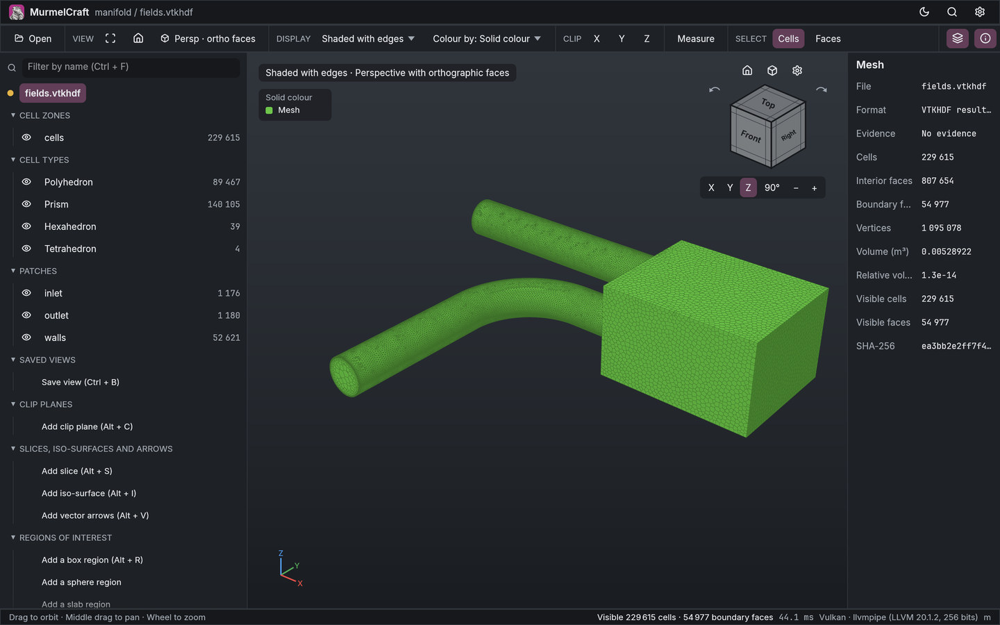
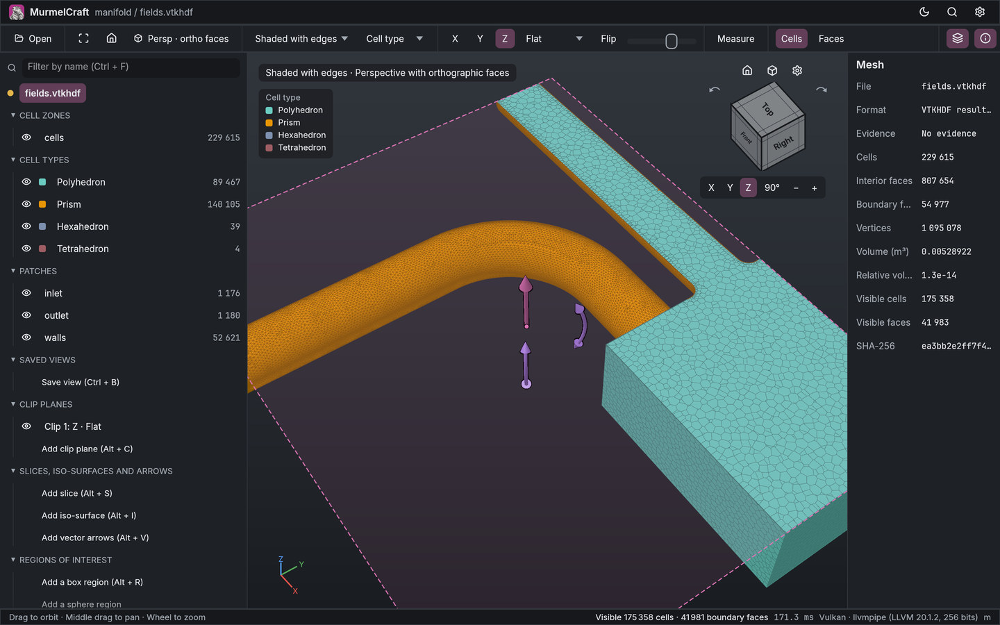
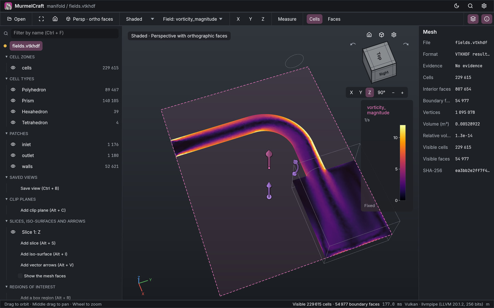
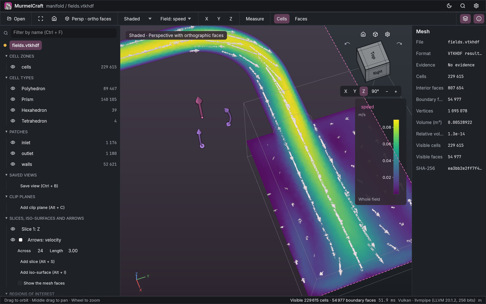
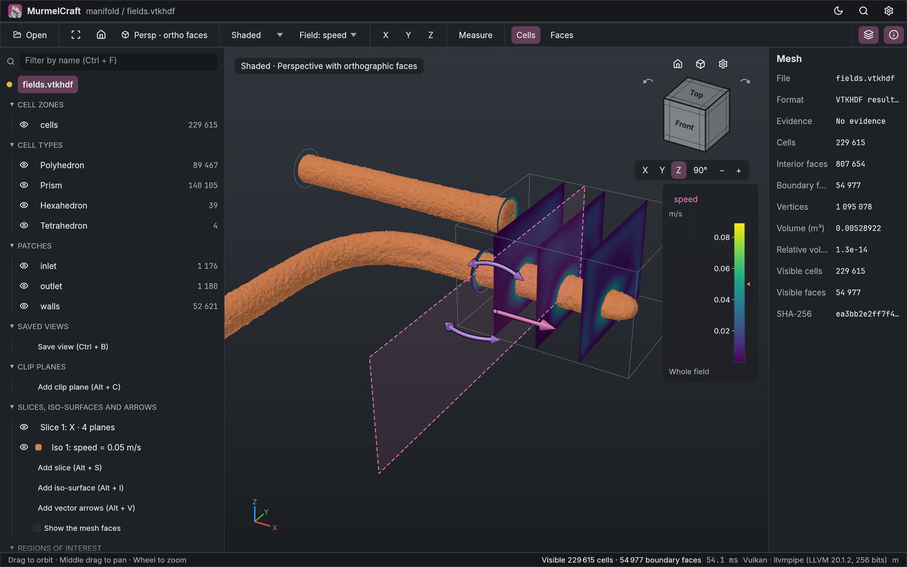
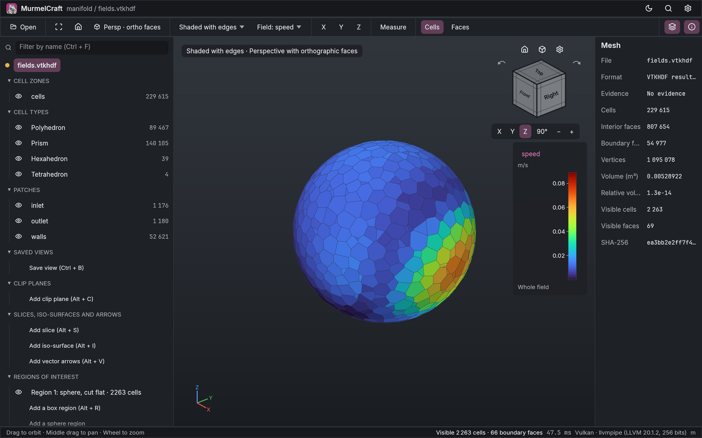
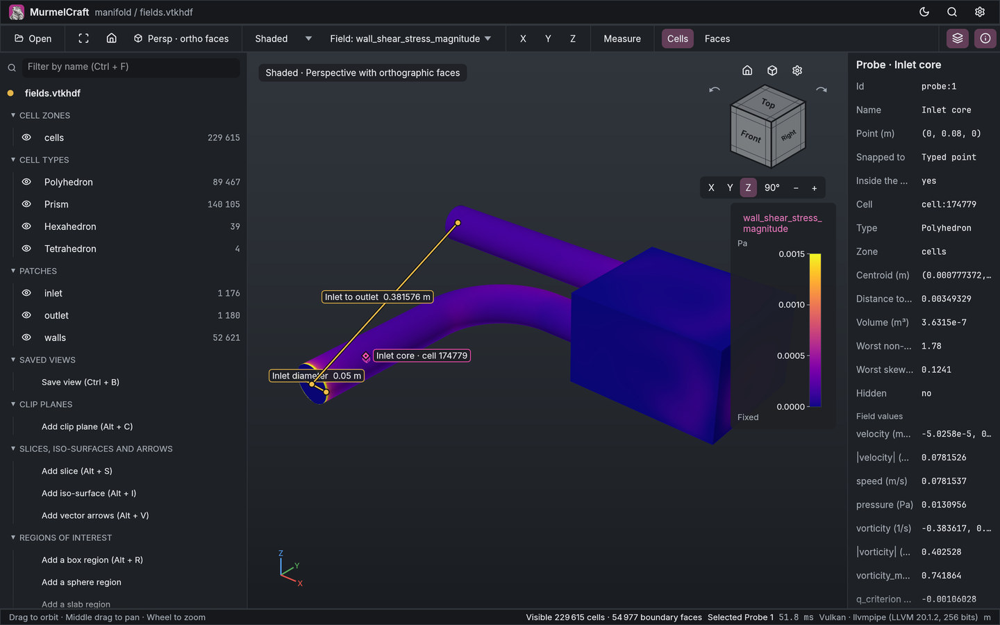
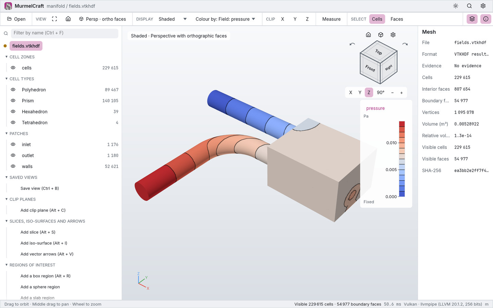

# Gallery

The slides of the README's slideshow as still images. Every picture is a
screenshot of the MurmelCraft window (1440 x 900, rendered at twice that
and scaled down), set up through the live MCP bridge (`murmel mcp --live`)
by [tools/readme-tour](../tools/readme-tour/README.md).

The data: KoflCraft's Manifold fixture (a pipe with a bend, a box, a
rounded junction and an outlet pipe; 50 mm pipes) meshed by
`kofl generate-duct … polyhedral` into 229,615 cells, a Voronoi
polyhedral core with prism layers at the walls. FoehnCraft solved laminar
air flow through it (inlet 0.05 m/s, Re = 167, steady SIMPLEC, converged
in 146 iterations) and wrote `fields.vtkhdf`, which MurmelCraft opens with
its own HDF5 reader.

## The mesh

The mesh as it opens: shaded with edges, the model tree with cell zones,
cell types and patches, the view cube and the properties.

## Cell types under a clip plane

Polyhedra and prisms by colour, cut flat through the outlet pipe and the
box; the plane's handles slide and tilt it.

## Vorticity on a slice

The mesh draws as a faint outline while a slice shows; the colour bar
holds a fixed range.

## Speed with vector arrows

Shaded 3D arrows of the velocity in the plane of the slice, on an even
grid.

## Slices and an iso-surface

A series of four slices and the iso-surface at 0.05 m/s, made by marching
tetrahedra in every cell.

## A region of interest

A sphere region cut flat: only its 2,263 cells are shown and computed,
each in its own colour (flat field style).

## Measurements and a probe

Two measured distances and a probe; the selected probe shows the values
of every field at its point.

## The light theme

Banded pressure with contour lines in the light theme.
